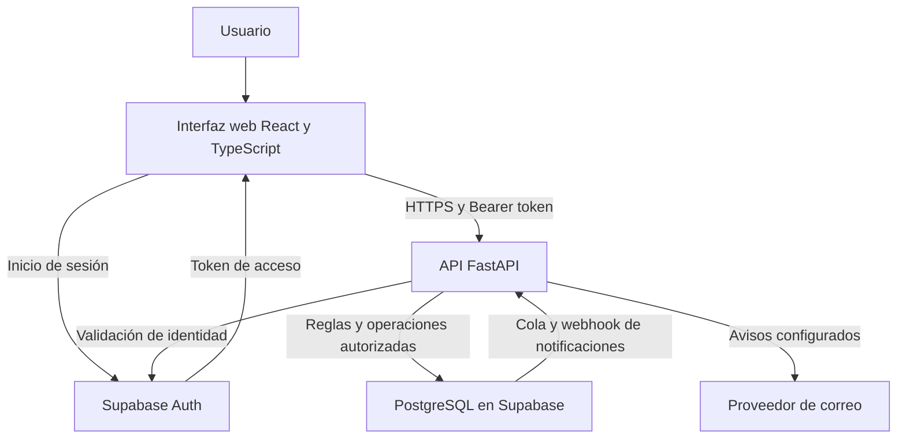

# HuellApp

**Aplicación web para la planificación, coordinación y trazabilidad de las actividades de Fundación Huella.**

HuellApp centraliza información de usuarios, colegios, cursos, contactos y actividades para apoyar el trabajo de Directiva, Coordinadores y Monitores. Su propósito es conectar lo que se planifica, las respuestas de quienes participan y los registros de lo realizado.

El proyecto es desarrollado por **Pudú Tech**, equipo de estudiantes de Ingeniería en Informática de **Duoc UC**, en el marco de su proyecto de título Capstone, para **Fundación Huella**.

**Estado:** en desarrollo y validación. **Entrega funcional prevista:** diciembre de 2026.

## Contenido

- [El proyecto](#el-proyecto)
- [Objetivos](#objetivos)
- [Usuarios y permisos](#usuarios-y-permisos)
- [Alcance y funcionalidades](#alcance-y-funcionalidades)
- [Estado del proyecto](#estado-del-proyecto)
- [Arquitectura](#arquitectura)
- [Repositorios](#repositorios)
- [Puesta en marcha](#puesta-en-marcha)
- [Calidad y seguimiento](#calidad-y-seguimiento)
- [Equipo](#equipo)
- [Entrega y continuidad](#entrega-y-continuidad)

## El proyecto

Fundación Huella trabaja con estudiantes mediante espacios de reflexión sobre temas relevantes para su desarrollo. La realización de estas actividades requiere coordinar colegios, personas, horarios y lugares, además de conservar información sobre la participación y ejecución de cada instancia.

Cuando estos antecedentes están distribuidos entre planillas, mensajería y documentos, resulta más difícil mantenerlos actualizados y consultar el estado de una actividad. HuellApp busca reunir los procesos prioritarios de la operación en una aplicación web, con acceso según las responsabilidades de cada usuario.

La solución permitirá responder preguntas como:

- ¿Qué actividades están programadas y dónde se realizarán?
- ¿Quiénes están asignados y qué respuesta han entregado?
- ¿Qué registros respaldan la asistencia y la realización de una actividad?
- ¿Qué información necesitan Directiva y Coordinadores para dar seguimiento al trabajo?

## Objetivos

### Objetivo general

Desarrollar y entregar a Fundación Huella una aplicación web funcional y validada que apoye la planificación, coordinación, registro y seguimiento de sus espacios de reflexión y actividades, conforme al alcance y los criterios de aceptación acordados.

### Objetivos específicos

1. Centralizar la información operativa de usuarios, colegios, cursos y contactos.
2. Facilitar la planificación de actividades y la asignación de participantes.
3. Permitir consultar la programación y registrar las respuestas de participación.
4. Respaldar la ejecución mediante asistencia, ubicación y ticket de salida, según las reglas definidas con Huella.
5. Apoyar el seguimiento mediante consultas, reportes y registros de auditoría con permisos diferenciados.
6. Entregar documentación, código fuente y orientaciones para la utilización y continuidad de la solución.

## Usuarios y permisos

| Perfil | Propósito dentro de la solución |
| --- | --- |
| **Directiva** | Administrar información y actividades y consultar antecedentes para coordinar la operación de la fundación. |
| **Coordinador** | Organizar y dar seguimiento a actividades y participantes dentro del ámbito y los permisos asignados. |
| **Monitor** | Consultar sus actividades, responder a las asignaciones y registrar su participación y ejecución mediante las funciones habilitadas. |
| **SUPERADMIN** | Realizar funciones de administración técnica autorizadas. Es un perfil técnico distinto de los roles operativos de Huella. |

Los permisos se verifican en el backend. La visibilidad de una opción en la interfaz no constituye por sí sola una autorización para consultar o modificar información.

## Alcance y funcionalidades

La primera entrega comprende las siguientes capacidades:

| Área | Capacidad contemplada |
| --- | --- |
| **Usuarios y acceso** | Autenticación, creación e invitación de cuentas, habilitación y acceso según rol. |
| **Información institucional** | Gestión de colegios, cursos, salas y contactos necesarios para organizar las actividades. |
| **Actividades y asignaciones** | Planificación de espacios de reflexión y otros tipos de actividad acordados, con participantes y datos de programación. |
| **Respuestas de participación** | Confirmación o rechazo de una participación y tratamiento de cambios según las reglas aplicables. |
| **Programación** | Consulta de actividades asignadas, fechas, horarios, ubicación y detalles necesarios para participar. |
| **Asistencia** | Registro asociado a la participación, con ubicación informada por el dispositivo y regularización según permisos. |
| **Ticket de salida** | Registro de lo realizado y de los datos de cierre acordados para la actividad. |
| **Seguimiento y auditoría** | Consultas, reportes mínimos y trazabilidad de los eventos definidos en el alcance detallado. |

**Aceptar una asignación confirma la participación:** no equivale a registrar asistencia ni a declarar realizada la actividad. Estos registros representan momentos diferentes del proceso.

La ubicación respalda el registro informado por el dispositivo; no constituye una prueba infalible de presencia física. Su consulta y tratamiento deben respetar los permisos y condiciones acordados.

### Recorrido operativo

1. Directiva o el perfil autorizado crea e invita una cuenta.
2. La persona completa la habilitación e inicia sesión.
3. Se crea una actividad y se asignan sus participantes.
4. Cada participante consulta la solicitud y registra su respuesta.
5. El usuario consulta su programación y los detalles de la actividad.
6. Se registra la asistencia y, al completar el flujo previsto, el ticket de salida.
7. Los perfiles autorizados consultan los antecedentes de seguimiento.

El recorrido describe el alcance del producto. Los pasos pendientes de completar o validar se indican en la sección siguiente.

## Estado del proyecto

La solución cuenta con código para autenticación y perfiles, gestión institucional, actividades, participantes, asistencia, auditoría y mecanismos de notificación. La disponibilidad de estos componentes no implica que todo el alcance haya sido aceptado por Fundación Huella.

| Frente | Situación al corte de esta revisión |
| --- | --- |
| **Acceso, información institucional y asignaciones** | Componentes presentes en el repositorio; se debe mantener la relación entre implementación, criterios y evidencia de pruebas. |
| **Asistencia** | Implementación y reglas disponibles para su verificación integral en el ambiente correspondiente. |
| **Avisos por correo** | Mecanismo de cola y despacho disponible; su operación requiere configurar y comprobar los servicios de envío. |
| **Ticket de salida** | Parte del alcance comprometido, con definición, implementación y validación pendientes de cierre. |
| **Seguimiento del Coordinador y reportes mínimos** | Contenido y validación pendientes de completar conforme a lo acordado con Huella. |
| **Recordatorios** | Eventos, canales y anticipación deben precisarse; no se presume incluido cualquier esquema de recordatorios. |
| **Entrega y traspaso** | Requieren validación del producto, preparación operativa, documentación y conformidad. |

**Referencia técnica:** rama `develop`, commit [`d2b651f42703`](https://github.com/Pudu-tech/Desarrollo_HuellApp/commit/d2b651f4270388cca337303a1b8adc03dbc891e1), del 20 de octubre de 2026. Rama e issues revisadas el **2 de noviembre de 2026**. El [backlog de GitHub](https://github.com/Pudu-tech/Desarrollo_HuellApp/issues) conserva el seguimiento operativo; cerrar una issue no sustituye la evidencia de aceptación.

## Arquitectura

La aplicación separa interfaz, lógica de negocio e infraestructura de datos.



| Componente | Tecnología | Función |
| --- | --- | --- |
| **Frontend** | React, TypeScript, Vite y React Router | Navegación, formularios y presentación de la información. |
| **Backend** | Python, FastAPI y Pydantic | API, validaciones, permisos y reglas de aplicación. |
| **Identidad** | Supabase Auth | Autenticación y gestión de la sesión. |
| **Persistencia** | PostgreSQL en Supabase | Entidades, relaciones, restricciones y funciones SQL. |
| **Despliegue** | Vercel | Alojamiento de frontend y backend según la configuración de cada ambiente. |
| **Correo** | Brevo y mecanismo de despacho del backend | Envío de avisos cuando el servicio y sus credenciales están configurados. |

Las dependencias y sus versiones declaradas se encuentran en [`frontend/package.json`](https://github.com/Pudu-tech/Desarrollo_HuellApp/blob/develop/frontend/package.json) y [`backend/requirements.txt`](https://github.com/Pudu-tech/Desarrollo_HuellApp/blob/develop/backend/requirements.txt).

## Repositorios

El proyecto mantiene separados el desarrollo de la aplicación y sus evidencias académicas.

| Repositorio | Contenido |
| --- | --- |
| [Desarrollo de HuellApp](https://github.com/Pudu-tech/Desarrollo_HuellApp) | Código fuente, configuración, migraciones, pruebas y documentación técnica de implementación. |
| [Documentación Capstone](https://github.com/Pudu-tech/huellacapstone) | Definición del proyecto, informes, planificación y evidencias organizadas por fase académica. |

### Organización del código

```text
Desarrollo_HuellApp/
├── frontend/
│   ├── src/                 # Interfaz, rutas y servicios de la aplicación
│   ├── tests/               # Archivos de pruebas del frontend
│   └── package.json         # Dependencias y scripts
├── backend/
│   ├── app/                 # API, configuración y servicios
│   ├── tests/               # Pruebas del backend
│   └── requirements.txt     # Dependencias de Python
├── supabase/
│   ├── migrations/          # Evolución del esquema y funciones SQL
│   ├── seeds/               # Estado del versionado de datos maestros
│   ├── tests/               # Pruebas SQL
│   └── docs/                # Consultas de verificación
└── docs/                    # Guías de módulos e implementación
```

### Documentación académica

- [Fase 1](https://github.com/Pudu-tech/huellacapstone/tree/main/Fase%201): antecedentes de definición, evaluación y planificación inicial.
- [Fase 2](https://github.com/Pudu-tech/huellacapstone/tree/main/Fase%202): desarrollo, seguimiento y evidencias de avance.
- [Fase 3](https://github.com/Pudu-tech/huellacapstone/tree/main/Fase%203): carpeta destinada a las evidencias de la fase final.
- [Flujo de Huella](https://github.com/Pudu-tech/huellacapstone/blob/main/Flujo%20Huella.drawio): antecedente de modelamiento del proceso.

La presencia de una carpeta o documento no acredita su aprobación ni el cierre de la fase. Las versiones históricas se conservan como antecedentes; el acta, el alcance y los criterios vigentes deben identificarse por versión.

## Puesta en marcha

Las instrucciones siguientes corresponden al **repositorio de desarrollo** y a un entorno local de pruebas.

### Requisitos previos

- Git.
- Node.js y npm compatibles con las dependencias del frontend.
- Python 3 compatible con las dependencias del backend.
- Acceso autorizado a un proyecto Supabase preparado para desarrollo o QA.
- Variables de entorno y una cuenta de prueba con perfil y rol válidos.

La clonación del repositorio no crea automáticamente la base de datos, los datos maestros ni las cuentas de acceso. Las versiones de los runtimes deben fijarse y comprobarse con la configuración de despliegue del equipo.

### Obtener el código

```bash
git clone --branch develop https://github.com/Pudu-tech/Desarrollo_HuellApp.git
cd Desarrollo_HuellApp
```

### Configurar el entorno

Crear `frontend/.env.local` con los valores del ambiente autorizado:

```dotenv
VITE_API_URL=http://127.0.0.1:8000
VITE_SUPABASE_URL=https://TU_PROYECTO.supabase.co
VITE_SUPABASE_PUBLISHABLE_KEY=TU_CLAVE_PUBLICA
```

Crear `backend/.env`:

```dotenv
APP_ENV=development
FRONTEND_URL=http://localhost:5173
CORS_ORIGINS=["http://localhost:5173"]
SUPABASE_URL=https://TU_PROYECTO.supabase.co
SUPABASE_SECRET_KEY=TU_CLAVE_PRIVADA_DE_SERVIDOR
```

Los valores anteriores son marcadores de ejemplo. La clave privada de Supabase y las credenciales de proveedores pertenecen al backend; no deben incorporarse a variables `VITE_*`, capturas, logs públicos o commits.

Las variables adicionales de correo y geocodificación se configuran únicamente si se habilitan esos servicios. Su detalle está en [`backend/app/core/config.py`](https://github.com/Pudu-tech/Desarrollo_HuellApp/blob/develop/backend/app/core/config.py), la [guía de correo](https://github.com/Pudu-tech/Desarrollo_HuellApp/blob/develop/docs/correos_vercel.md) y la [guía de asistencia](https://github.com/Pudu-tech/Desarrollo_HuellApp/blob/develop/docs/asistencia.md).

### Iniciar el backend

Desde la raíz del código, en Windows PowerShell:

```powershell
cd backend
python -m venv .venv
.\.venv\Scripts\python.exe -m pip install -r requirements.txt
.\.venv\Scripts\python.exe -m uvicorn app.main:app --reload
```

En macOS o Linux, utilizar `.venv/bin/python` en lugar de `.\.venv\Scripts\python.exe`.

El servidor local utiliza por defecto `http://127.0.0.1:8000`. En configuración de desarrollo, la documentación interactiva de la API se encuentra en `/docs`.

### Iniciar el frontend

En otra terminal, desde la raíz del código:

```bash
cd frontend
npm ci
npm run dev
```

Abrir la URL indicada por Vite, normalmente `http://localhost:5173`. El origen utilizado debe coincidir con la configuración CORS del backend y las URL permitidas de autenticación.

### Preparar la base de datos

Revisar el [README de Supabase](https://github.com/Pudu-tech/Desarrollo_HuellApp/blob/develop/supabase/README.md), las migraciones posteriores y el estado de los datos maestros antes de crear un ambiente nuevo. El baseline documenta un esquema existente y no garantiza por sí solo una instalación completa desde cero.

No volver a ejecutar el baseline sobre una base existente. Las migraciones deben revisarse según sus dependencias, el ambiente y el historial aplicado. Los cambios que reconstruyen estructuras o eliminan datos requieren una preparación específica.

El [registro de seeds](https://github.com/Pudu-tech/Desarrollo_HuellApp/blob/develop/supabase/seeds/README_SEEDS.md) identifica datos maestros pendientes de versionar. Los datos ficticios de QA se mantienen separados de la información real autorizada por Huella.

### Ambiente de desarrollo compartido

La URL utilizada para las pruebas guiadas es [HuellApp en Vercel](https://huellapp-frontend-git-develop-huell-app.vercel.app/). Requiere una cuenta autorizada y puede cambiar con los despliegues de desarrollo; no representa por sí sola una entrega productiva aceptada.

## Calidad y seguimiento

El trabajo se organiza mediante un backlog priorizado, desarrollo incremental, revisión de avances, pruebas y actualización documental, bajo un enfoque Scrum adaptado al contexto del proyecto.

Cada funcionalidad debe relacionar:

**Necesidad → requisito → tarea → implementación → prueba → evidencia de aceptación.**

El cierre requiere comprobar criterios, permisos, manejo de errores y persistencia cuando corresponda. Los resultados de QA deben identificar fecha, entorno, rol, versión, responsable y evidencia. Las correcciones requieren repetir las pruebas afectadas.

### Comprobaciones técnicas

Desde `frontend/`:

```bash
npm run build
npm run lint
```

El `package.json` revisado no declara un script `npm test`. Los archivos de prueba existentes deben ejecutarse conforme a su mecanismo documentado.

El backend contiene pruebas con `unittest`. Desde `backend/`, con dependencias y configuración de prueba preparadas:

```powershell
.\.venv\Scripts\python.exe -m unittest discover -s tests -p "test_*.py"
```

La presencia de estos comandos o de archivos de prueba no implica que los controles estén aprobados. La aceptación se basa en los resultados registrados para la versión entregada, el alcance acordado y el **Definition of Done** vigente.

Para reportar un problema, registrar la funcionalidad afectada, pasos para reproducir, resultado esperado, resultado observado, entorno, versión y evidencia sin datos sensibles.

## Equipo

**Pudú Tech** es el nombre del equipo desarrollador; no corresponde a una empresa constituida.

| Integrante | Rol | Responsabilidad principal |
| --- | --- | --- |
| **Matías Eduardo Morales Inzulza** | Project Manager | Coordinación general, planificación, documentación y seguimiento de evidencias y compromisos. |
| **Felipe Ignacio Ferrada Pacheco** | Product Owner | Comunicación directa con Huella, aclaración de necesidades, priorización y revisión funcional. |
| **Ignacio Alonso Messina Luna** | Jefe de desarrollo | Coordinación técnica, arquitectura, desarrollo, integración y calidad de los incrementos. |

La contraparte institucional es **Isadora Roos Pizarro, Directora Ejecutiva de Fundación Huella**. Los roles del equipo permiten colaboración en desarrollo, pruebas y documentación según las necesidades del proyecto.

## Entrega y continuidad

La planificación contempla una entrega funcional durante **diciembre de 2026**, acompañada de código fuente, documentación de uso y técnica, resultados de pruebas y registro de validación y conformidad. El día de entrega y los hitos específicos se precisarán en la planificación acordada.

La propuesta de continuidad contempla **tres meses de soporte correctivo desde la firma de conformidad**, bajo las condiciones que se formalicen en el acta vigente. La administración posterior, el mantenimiento adicional y las nuevas funcionalidades requieren acuerdos específicos.

El desarrollo académico se realiza sin cobro de honorarios a Fundación Huella. Los servicios externos necesarios para operar la aplicación deben tener costos, titulares y responsables definidos; no se presume que su operación sea gratuita o esté financiada por el equipo.

Los permisos de uso, modificación, mantenimiento por terceros y reutilización del código se formalizan en los acuerdos correspondientes. Los datos, contenidos e información confidencial de Huella se tratan conforme a las autorizaciones y obligaciones asumidas. Este README no sustituye dichos acuerdos ni asigna una licencia de software por sí mismo.

### Evolución posterior

Podrán evaluarse ampliaciones como la vinculación con una plataforma de e-learning, una aplicación móvil nativa, analítica avanzada u otras necesidades de Huella. Su incorporación requerirá definir alcance, responsables, plazos, costos y criterios de aceptación mediante un anexo o acuerdo específico.

WhatsApp y otros servicios de mensajería no se consideran incluidos automáticamente: su necesidad, integración y costo deben evaluarse y acordarse.

---

**Última revisión del README:** 2 de noviembre de 2026.
