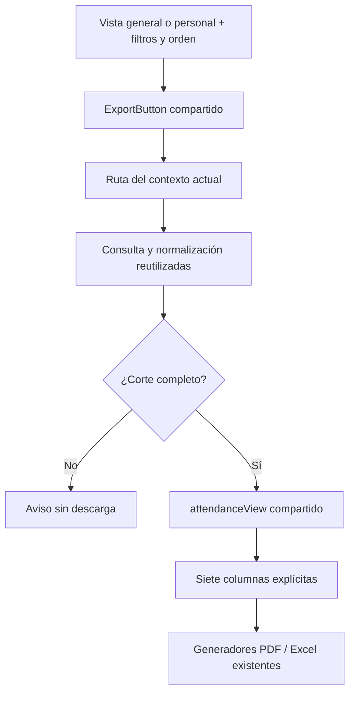

# INC-03 — Exportación de Asistencia

Decisión de Matías, 15-11-2026: replicar el funcionamiento de Usuarios e Instancias en Asistencia, priorizando reutilizar el código disponible. Base: rama Exportacion_PDF_XLSX, HEAD 188cbf23693e329ac98e3cdf4a00bc7ee9dc29c0 y los cambios locales de INC-02, conservados sin sobrescribir.

## Alcance y reutilización

Exportar comparte la cabecera y altura con Actualizar; reutiliza ExportButton, su menú Excel/PDF y estilos. Usa createXlsx/createPdf/downloadTable sin modificarlos. No agrega librerías, fuentes, tablas, migraciones, permisos, registros de descarga ni conversiones externas.

La exclusión de exportaciones de readCache se extiende a las dos rutas de Asistencia: no guarda sus respuestas ni comparte solicitudes pendientes. Se amplía la prueba de caché existente para los cuatro endpoints generales/personales de los incrementos.

La consulta existente _list_rows se separa en _list_query y _normalize_rows para que listado y descarga reutilicen exactamente las mismas relaciones, exclusiones lógicas, usuario propietario, normalización de precisión y estado efectivo. Se conservan las rutas normales y los contratos de consulta/regularización. No se crea otro router ni se cambia main.py.

attendanceView extrae los filtros y los cuatro criterios de orden del listado: lo consumen pantalla y archivo. Se reutiliza sortList. Las funciones attendanceOf, attendancePerson y attendanceState evitan duplicar esas transformaciones.

## Consulta, permisos y corte

| Contexto | Ruta GET | Autorización existente |
| --- | --- | --- |
| General | /asistencias/exportacion | VIEW_ASSIGNMENTS y SUPERADMIN, DIRECTIVA o COORDINADOR; visibilidad general actual |
| Personal | /asistencias/mias/exportacion | REPORT_ATTENDANCE; usuario_id fijado exclusivamente a actor.id autenticado |

La pantalla conserva su selector actual: Directiva/Coordinación alternan general/personal; Monitor consulta solo la personal; Superadmin conserva la general. Una exportación personal nunca recurre al listado general. La restricción futura por colegio de #61 sigue pendiente.

Cada formato prepara un nuevo corte sin caché, con una sola consulta de datos Supabase y count='exact'. Fechas inclusivas e instancia seleccionada se aplican antes del conteo. La relación asignacion ya usaba !inner; por ello sus filtros de fecha afectan también las filas raíz. Estado efectivo y búsqueda se aplican después en el selector compartido, manteniendo las reglas originales. No se filtra directamente el estado físico: PENDIENTE con invitación RECHAZADA se presenta como NO_REQUERIDA, conforme al código existente.

Se pide un máximo de 10.000 participaciones; Supabase puede limitar antes. Si total no coincide con filas recibidas o excede el máximo, 422 sin archivo y sin pedir otra página. Conteo inválido o fallo: 503 con mensaje controlado. El conjunto previo a búsqueda/estado debe caber completo, aunque el resultado final sea pequeño. Esta limitación es consecuencia de la decisión de una única consulta.

Las relaciones de esta consulta son a uno; asistencias_asignacion tiene UNIQUE(asignacion_participante_id) en supabase/migrations/010_redisenio_modulo_asignaciones.sql. No se incorpora el control doble de listas embebidas de Instancias, porque aquí cada fila ya es un participante. Se conservan las formas objeto/lista del contrato existente.

generated_at marca el inicio de preparación del backend en UTC y se muestra en America/Santiago. No es un timestamp de PostgreSQL ni una garantía de que dos descargas realizadas en momentos distintos sean idénticas.

Mientras se prepara/genera el archivo se pausan refresco automático, filtros, orden y cambio de vista; Actualizar también queda bloqueado. Con un formulario de asistencia abierto se deshabilita Exportar. El corte reemplaza solo la instancia/fechas consultadas; al limpiar filtros se conservan las filas anteriores fuera de ese contexto.

## Columnas y formatos

| Columna | Valor |
| --- | --- |
| Fecha | DD/MM/AAAA, como el listado |
| Actividad | Nombre |
| Colegio / lugar | Colegio o lugar libre |
| Participante | Nombre completo |
| Participación | Código del estado de invitación, como la pantalla |
| Asistencia | Estado efectivo, No requerida o Sin registro |
| Ubicación / motivo | Dirección, enlace de Maps representado como texto con URL, precisión redondeada, motivo y motivo de regularización, cuando aparecen en el listado |

Se excluyen Acciones, identificadores internos, horarios no mostrados en esa columna y los demás campos de la API. La URL de Maps usa las coordenadas que ya recibe y enlaza la vista; no se consulta Maps ni se geolocaliza al exportar. Los textos y la URL se escriben como cadenas, sin fórmulas ni hipervínculos activos en XLSX. PDF adapta el diseño al papel; no es una captura del DOM.

Se reutilizan Noto Sans, encabezados, bordes y paginación PDF A4 horizontal. XLSX conserva hoja del listado y hoja Consulta con contexto, corte, filtros, orden y cantidad. Nombres: huellapp_asistencias_FECHA y huellapp_mis_asistencias_FECHA. Cero resultados, carga pendiente, rango inválido, sesión vencida o fallos muestran estados claros; no se entrega un archivo vacío engañoso o parcial.

## Archivos del incremento

- backend/app/api/asistencias.py: refactor mínimo de consulta/normalización y dos rutas de exportación.
- frontend/src/pages/AsistenciaPage.tsx: integra el control y el corte, bloqueos temporales y selector compartido.
- frontend/src/utils/attendanceExport.ts: filtros/orden/proyección y combinación contextual de filas.
- backend/tests/test_attendance_exports.py y frontend/tests/attendanceExport.test.mjs: pruebas nuevas.
- frontend/src/services/readCache.ts y frontend/tests/readCache.test.mjs: amplían la exclusión y las pruebas existentes de caché.
- docs/exportacion_asistencias.md y docs/exportacion_consultas.md: decisiones, evidencia y alcance.

## Evidencia obtenida y pendiente

| Criterio | Evidencia local | Pendiente |
| --- | --- | --- |
| Filtros, orden, columnas, vacíos y combinación contextual | 8 pruebas frontend: noviembre inclusivo, búsqueda, estado/instancia, cuatro órdenes en ambos sentidos, objeto/lista, motivos, coordenadas cero y textos similares a fórmulas | Revisión de Matías con sus datos |
| Consulta única, filtros, conteo, errores y autorización | 14 pruebas backend con constructor PostgREST real y HTTP simulado; incluye Monitor rechazado en general, propietario autenticado, rutas/permisos y sin fallback personal→general | Validar relaciones, límites y permisos contra Supabase DEV/QA |
| Reglas existentes y regresiones | 12 pruebas de asistencia (panel/estado), 25 de exportaciones Usuarios/Instancias y 16 de frontend comunes/anteriores | — |
| Recorrido de interfaz | Página real AsistenciaPage en Edge, identidad y servicios simulados: PDF/XLSX general, Excel personal de Directiva y Monitor, instancia, siete columnas/cuatro filas de noviembre, orden descendente, botones alineados, bloqueos temporales y edición, límites/sesión sin descarga | Cuentas reales y ambos formatos por perfil |
| Archivos | PDF renderizado con Poppler e inspeccionado; Excel reabierto con ExcelJS, nombres y metadatos verificados | Apertura manual y aceptación visual del equipo; volumen operativo acordado |
| Caché | 7 pruebas de readCache; cada ruta de exportación requiere respuestas nuevas, también con solicitudes simultáneas | — |
| Calidad | Build y ESLint dirigido correctos; advertencia existente de chunks grandes | Se observó recorte horizontal del layout general de la página en la vista móvil aislada; el menú cabe en 360 px. No se certifica toda la página móvil |

Total: **82 pruebas automatizadas (51 backend y 31 frontend)**. Los servicios simulados no equivalen a una prueba del ambiente publicado. No se hicieron solicitudes a Supabase real, escrituras de datos, migraciones, commit, push ni despliegue.

Reproducir backend desde backend: python -B -m unittest discover -s tests -p test_attendance_exports.py; patrones adicionales test_attendance_panel.py, test_attendance_status.py, test_assignment_exports.py, test_user_export_query.py. Frontend: node --experimental-vm-modules --test tests/attendanceExport.test.mjs tests/assignmentsExport.test.mjs tests/queryExport.test.mjs tests/usersExport.test.mjs tests/listSort.test.mjs tests/asignacionesListado.test.mjs tests/readCache.test.mjs; npm run build; ESLint de los archivos frontend nuevos/modificados. Los artefactos y el runner de navegador ficticios quedan en work/inc03_asistencias/repo/verification del espacio de esta conversación, fuera del repositorio real.
