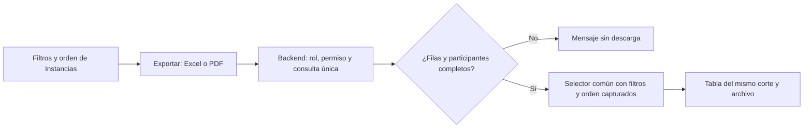

# INC-02 — Exportación de Instancias

## Actualización del 17-11-2026

Después de integrar develop, Instancias agregó coordinador, monitor, curso y búsqueda por palabras sin tildes. La exportación se adapta a ese listado mediante la corrección documentada en [correccion_exportacion_instancias_filtros.md](correccion_exportacion_instancias_filtros.md): selector compartido, campos nuevos, columnas según perfil y alcance de Coordinación reutilizado del backend vigente. Esta actualización sustituye la selección, columnas y descripción de visibilidad general de la versión inicial que se conserva a continuación como registro histórico. No acredita cierre de #61.

## Registro inicial de INC-02

## Encargo y fuentes

Matías solicita extender a Instancias la exportación de Usuarios. Se mantienen las decisiones de INC-01: PDF/XLSX, columnas del listado, menú debajo de Exportar junto a Actualizar, sin modal y una consulta de datos completa o rechazo sin descarga parcial. Relacionado con #63 (https://github.com/Pudu-tech/Desarrollo_HuellApp/issues/63).

Decisión explícita en este incremento: habilitar también a COORDINADOR con la visibilidad general que ya tiene el listado, además de SUPERADMIN/DIRECTIVA, exigiendo VIEW_ASSIGNMENTS. Esta autorización no acredita que el ámbito por colegio acordado con Huella esté implementado: #61 (https://github.com/Pudu-tech/Desarrollo_HuellApp/issues/61) permanece pendiente. MONITOR no exporta el listado general; Mis instancias y Asistencia están fuera de INC-02.

Estado inicial: AsignacionesPage filtra y ordena en el navegador el resumen administrativo. La API no comprueba completitud y los generadores comunes contienen nombre y anchos predeterminados de Usuarios. Se reutilizan las reglas de resumen de asistencia, participantes y Por reasignar del backend.

## Criterios de aceptación

1. Exportar se sitúa junto a Actualizar, en la misma fila, con desplegable Excel/PDF. Carga, lista filtrada vacía, fechas inválidas y generación en curso impiden una nueva descarga.
2. Se exportan Actividad, Colegio / Lugar, Asignada a, Fecha, Horario, Estado y Asistencia, sin Acciones ni UUID. Los nombres múltiples conservan saltos de línea. No se agregan datos del detalle ni ubicaciones GPS.
3. Se conservan búsqueda, tipo, colegio, estado, Por reasignar, rango inclusivo y Solo próximas, y los cuatro órdenes disponibles en ambos sentidos. Pantalla y archivo comparten el mismo selector puro. Solo próximas conserva la regla actual de excluir estados terminales; no añade una comparación nueva con el reloj.
4. GET /exports/assignments usa una única consulta PostgREST con conteo exacto. Fecha, colegio, tipo y estado ordinario reducen la consulta en servidor. Búsqueda, Por reasignar y Solo próximas se aplican con el selector común del frontend sobre ese conjunto completo. Si el conjunto previo a esos filtros supera el límite de respuesta, se rechaza: no se promete resolver filtros residuales sobre datos faltantes.
5. El corte incluye nombres de actividad, estado y colegio en la misma consulta. Se actualizan las etiquetas y las filas de ese contexto en pantalla conservando las filas cargadas fuera de él, sin alterar filtros ni perderlas al limpiarlos. Se pausa el refresco de fondo y se bloquean filtros/orden/Actualizar/Crear durante la generación.
6. El conteo debe ser válido y coincidir con las filas recibidas. Hay salvaguarda de 10.000 filas solicitadas; el límite efectivo puede ser menor. No se cambia configuración, no hay paginación ni migraciones.
7. También se comprueba la completitud de los participantes embebidos: se leen los IDs vigentes en orden ascendente y descendente mediante dos alias de la MISMA consulta. Si los conjuntos difieren, hubo recorte y se rechaza. Se conservan las reglas actuales de nombres, Por reasignar y asistencia. La asistencia es relación única por participante en la migración 010.
8. Los archivos se llaman huellapp_instancias_*.xlsx/pdf, muestran los filtros y el orden, respetan los datos como texto y se abren legiblemente. Usuarios conserva sus nombres de archivo, columnas y valores predeterminados.
9. Un fallo, sesión inválida o falta de conteo produce un mensaje sin archivo parcial. Ni exportar ni su consulta modifican datos.

## Implementación

- backend/app/api/assignment_exports.py y registro en main.py: corte, permisos, validación de fechas, conteos y relaciones.
- frontend/src/utils/assignmentsExport.ts: selector común de pantalla/archivo, proyección y actualización contextual.
- AsignacionesPage.tsx: entrada habitual, parámetros y bloqueo temporal.
- queryExport.ts: nombre de archivo, anchos y metadatos opcionales por vista; altura para saltos de línea.
- asignaciones.css: altura del botón Actualizar en esta cabecera.
- ExportButton y las bibliotecas existentes se reutilizan; no se agregan dependencias ni cambios SQL.

## Pruebas y resultados

| Criterio | Estado | Evidencia | Pendiente |
| --- | --- | --- | --- |
| Filtros, siete columnas y orden compartidos | Verificado localmente | 6 pruebas assignmentsExport.test.mjs; noviembre inclusivo, búsqueda, colegio, tipo, estado, Por reasignar, próximas y cuatro órdenes en ambos sentidos | Revisión de Matías con sus datos |
| Consulta única, conteo y relaciones completas | Verificado localmente | 13 pruebas test_assignment_exports.py con constructor PostgREST real y HTTP simulado; recortes raíz/participantes rechazados sin segunda petición | Validar relaciones y límites del Supabase real |
| Superadmin, Directiva y Coordinación; Monitor rechazado | Verificado localmente | Roles y dependencia VIEW_ASSIGNMENTS en las pruebas; decisión de Matías registrada arriba | Prueba autenticada por los tres perfiles |
| Archivos PDF/XLSX y entrada habitual | Verificado localmente | Página real AsignacionesPage en Edge con servicios simulados: noviembre descendente, cuatro filas/siete columnas, nombres múltiples, filtros en metadatos, conservación de otros meses al limpiar y error sin descarga. Menú anclado y misma altura en escritorio; menú dentro de viewport móvil de 360 px | Recorrido DEV/QA y aceptación visual |
| PDF legible y Excel utilizable | Verificado localmente | PDF A4 horizontal renderizado con Poppler e inspeccionado; Excel reabierto con ExcelJS | Apertura manual por el equipo |
| Usuarios conserva su comportamiento | Verificado localmente | 12 pruebas de backend y regresiones frontend; 2 pruebas queryExport.test.mjs comprueban nombre huellapp_usuarios, seis columnas, texto seguro y formatos opcionales de Instancias | — |
| Compilación y análisis dirigido | Verificado | npm run build y eslint de archivos modificados correctos. Continúa advertencia de chunks grandes de las librerías diferidas | Lint general mantiene hallazgos previos ajenos al incremento |

Se ejecutaron 41 pruebas automatizadas: 25 de backend (13 Instancias + 12 Usuarios) y 16 de frontend (selectores, ordenamiento, proyección y generadores). Las pruebas de navegador usan la página real, pero interceptan los servicios con datos ficticios: no demuestran por sí solas el funcionamiento del backend desplegado ni de Supabase.

Ejecución reproducible: desde backend, python -B -m unittest discover -s tests -p test_assignment_exports.py y el patrón test_user_export_query.py. Desde frontend, node --test tests/assignmentsExport.test.mjs tests/queryExport.test.mjs tests/usersExport.test.mjs tests/listSort.test.mjs tests/asignacionesListado.test.mjs. La prueba aislada de navegador y los archivos ficticios quedaron en work/inc02_instancias/repo/verification dentro del espacio de trabajo de esta conversación; no se incorporan a la aplicación.

Los cambios son locales y revisables. No se hicieron commits, push, publicaciones de issues, migraciones ni despliegues en este incremento. El punto de partida fue la rama Exportacion_PDF_XLSX limpia, commit 188cbf2, que ya incluía INC-01. No se propone cerrar #63 ni #61 con esta evidencia.
